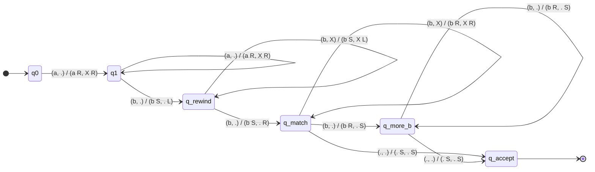
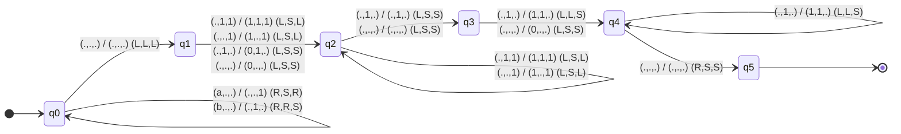

# Simulador de Máquina de Turing Determinista Multicinta

> **Asignatura:** Complejidad Computacional — Práctica 2  
> **Autor:** Guillermo Lopez Concepcion  
> **Fecha:** 18 Oct 2026  
> **Lenguaje:** C++17  
> **Estilo:** Google C++ Style Guide  
> **Documentación:** Doxygen  

---

## Índice

1. [Descripción](#descripción)
2. [Variaciones de la MT elegidas y fijadas](#variaciones-de-la-mt-elegidas-y-fijadas)
3. [Estructura del proyecto](#estructura-del-proyecto)
4. [Formato del fichero de configuración (.mt)](#formato-del-fichero-de-configuración-mt)
5. [Validación formal implementada](#validación-formal-implementada)
6. [Compilación](#compilación)
7. [Ejecución](#ejecución)
8. [Máquinas de Turing diseñadas (Problemas entregados)](#máquinas-de-turing-diseñadas-problemas-entregados)
   - [Problema 1: Lenguaje L = { aⁿ bᵐ \| m ≥ n, n > 0 }](#problema-1-lenguaje-l---an-bm--m--n-n--0-)
   - [Problema 2: Contador y separador unario de 'b's y 'a's (3 Cintas, 6 Estados)](#problema-2-contador-y-separador-unario-de-bs-y-as-3-cintas-6-estados)
9. [Principios SOLID y diseño orientado a objetos](#principios-solid-y-diseño-orientado-a-objetos)

---

## Descripción

Este software es un simulador de **Máquina de Turing (MT) determinista multicinta** desarrollado en C++17 siguiendo las pautas de ingeniería de software (SOLID, Google C++ Style Guide y Doxygen).

La máquina recibe la definición formal de una MT desde un fichero de configuración (`.mt`) y una o varias cadenas de entrada (por línea de comandos o teclado), ejecutando la simulación paso a paso e indicando:
- Si la MT se ha detenido en un estado de aceptación ($s \in F$) o de rechazo ($s \notin F$).
- El contenido de cada cinta con la posición de la cabeza lectora/escritora indicada entre corchetes (ejemplo: `ab[c]d`).

---

## Variaciones de la MT elegidas y fijadas

De acuerdo con las opciones permitidas en el enunciado de la práctica, se han fijado e implementado las siguientes variaciones:

1. **Movimientos de la cabeza:** Se incluye la posibilidad de movimiento hacia la izquierda (`L`), hacia la derecha (`R`) y parada / no movimiento (`S` de *Stay*).
2. **Escritura y movimientos independientes:** Cada cinta dispone de su propia cabeza de L/E. En cada transición, cada cinta puede escribir un símbolo distinto y moverse en una dirección independiente.
3. **Cinta infinita en ambas direcciones:** Las cintas no tienen límite a la izquierda ni a la derecha. Se modelan mediante memoria dispersa (`std::map<int, char>`), permitiendo índices negativos sin desbordamiento.
4. **Semántica de parada:** La finalización de la ejecución viene **determinada únicamente por la ausencia de transiciones** aplicables al estado y símbolos actuales. Al detenerse, se comprueba si el estado actual pertenece al conjunto de estados de aceptación $F$.

---

## Estructura del proyecto

```
CC-Maquina_Turing/
├── CMakeLists.txt          # Configuración de compilación CMake
├── README.md               # Memoria técnica del proyecto
├── include/                # Cabeceras (.h)
│   ├── state.h             # Clase State (SRP: identidad de estados)
│   ├── tape.h              # Clase Tape (cinta infinita bidireccional)
│   ├── transition.h        # Clase Transition y estructura TapeAction
│   ├── tm_parser.h         # Clase TuringMachineParser y TuringMachineConfig
│   └── turing_machine.h    # Clase TuringMachine (motor de simulación)
├── src/                    # Implementación (.cc)
│   ├── state.cc
│   ├── tape.cc
│   ├── transition.cc
│   ├── tm_parser.cc
│   ├── turing_machine.cc
│   └── main.cc             # CLI y gestión de entradas múltiples
├── build/                  # Directorio de artefactos de compilación
└── examples/               # Definiciones .mt y ficheros de prueba
    ├── anbm.mt             # Problema 1: L = { a^n b^m | m >= n, n > 0 }
    ├── test_anbm.txt       # Batería de pruebas para anbm.mt
    ├── count_ab.mt         # Problema 2: Contador unario de 'b's y 'a's
    └── test_count_ab.txt   # Batería de pruebas para count_ab.mt
```

---

## Formato del fichero de configuración (.mt)

El simulador lee el fichero ignorando:
- Líneas vacías o compuestas sólo por espacios en blanco.
- Comentarios completos (líneas que empiezan por `#`).
- Comentarios en línea (cualquier texto a la derecha del carácter `#`).

Las secciones deben aparecer en el siguiente orden estricto:

| Línea | Componente formal | Descripción | Ejemplo |
|:---:|:---:|---|---|
| 1 | $Q$ | Conjunto de estados separados por espacios | `q0 q1 q2 q_accept` |
| 2 | $\Sigma$ | Alfabeto de entrada | `a b` |
| 3 | $\Gamma$ | Alfabeto de la cinta (debe incluir el blanco) | `a b X .` |
| 4 | $s$ | Estado inicial ($s \in Q$) | `q0` |
| 5 | $b$ | Símbolo blanco ($b \in \Gamma$, $b \notin \Sigma$) | `.` o `-` |
| 6 | $F$ | Conjunto de estados de aceptación ($F \subseteq Q$) | `q_accept` |
| 7 | $N$ | Número de cintas ($N \ge 1$) | `2` |
| 8+ | $\delta$ | Transiciones (una por línea) | Ver formato a continuación |

### Formato de cada transición para $N$ cintas:

Cada transición contiene exactamente $2 + 3N$ tokens:

$$\underbrace{q_{\text{actual}}}_{\in Q} \quad \underbrace{a_1 \dots a_N}_{\in \Gamma^N} \quad \underbrace{q_{\text{siguiente}}}_{\in Q} \quad \underbrace{(w_1, m_1) \dots (w_N, m_N)}_{(\Gamma \times \{L,R,S\})^N}$$

Ejemplo para 2 cintas:
```text
q0 a . q1 a R X R
```
*(Estando en `q0`, leyendo `'a'` en Cinta 1 y `'.'` en Cinta 2: escribe `'a'` y avanza `'R'` en Cinta 1, escribe `'X'` y avanza `'R'` en Cinta 2, y pasa a `q1`)*.

---

## Validación formal implementada

El parser verifica rigurosamente las restricciones de la 7-tupla formal $M = (Q, \Sigma, \Gamma, s, b, F, \delta)$:
- $Q \neq \emptyset, \Sigma \neq \emptyset, \Gamma \neq \emptyset$.
- $s \in Q$: el estado inicial debe pertenecer al conjunto de estados.
- $F \subseteq Q$: todos los estados de aceptación deben pertenecer a $Q$.
- $b \in \Gamma$: el símbolo blanco debe pertenecer al alfabeto de cinta.
- $b \notin \Sigma$: el símbolo blanco **no** puede pertenecer al alfabeto de entrada.
- $\Sigma \subseteq \Gamma$: el alfabeto de entrada debe estar contenido en el de cinta.
- Para cada transición: estados origen y destino en $Q$, símbolos leídos/escritos en $\Gamma$ y direcciones en $\{L, R, S\}$.
- **Determinismo estricto:** detección de transiciones duplicadas para una misma clave $(q, \text{símbolos})$.

---

## Compilación

El proyecto utiliza CMake (versión mínima 3.16) y se compila directamente desde la terminal con las advertencias más estrictas del estándar de Google:

```bash
# Situarse en la raíz del proyecto
mkdir -p build && cd build
cmake .. -DCMAKE_BUILD_TYPE=Release
make -j4
```

El binario ejecutable generado se ubica en:
```bash
build/turing_machine
```

---

## Ejecución

El programa acepta los argumentos por línea de comandos requeridos:

```bash
./build/turing_machine -config <fichero.mt> [-in <fichero_entrada>]
```

- `-config <f>`: Ruta al fichero con la definición de la MT (**obligatorio**).
- `-in <f>`: Ruta al fichero con las cadenas de entrada a evaluar (**opcional**). Si el fichero contiene múltiples líneas, se ejecuta cada cadena secuencialmente.
- Si se omite `-in`, el programa entra en modo interactivo leyendo cadenas desde el teclado (hasta pulsar `Ctrl+D` / EOF).

### Ejemplos de uso directo

```bash
# Probar el Problema 1 con múltiples casos de prueba
./build/turing_machine -config examples/anbm.mt -in examples/test_anbm.txt

# Probar el Problema 2 con múltiples casos de prueba
./build/turing_machine -config examples/count_ab.mt -in examples/test_count_ab.txt

# Probar una cadena introducida por teclado
./build/turing_machine -config examples/count_ab.mt
```

---

## Máquinas de Turing diseñadas (Problemas entregados)

### Problema 1: Lenguaje $L = \{ a^n b^m \mid m \ge n, n > 0 \}$
- **Fichero de configuración:** `examples/anbm.mt`
- **Fichero de pruebas:** `examples/test_anbm.txt`

#### Definición formal:
- $Q = \{ q0, q1, q\_rewind, q\_match, q\_more\_b, q\_accept \}$
- $\Sigma = \{ a, b \}$
- $\Gamma = \{ a, b, X, . \}$
- $s = q0$
- $b = .$
- $F = \{ q\_accept \}$
- $N = 2$ cintas.

#### Algoritmo:
1. **Fase 1 ($q0 \to q1$):** Se exige al menos una `'a'` inicial ($n > 0$). Para cada `'a'`, se escribe una marca `'X'` en la Cinta 2 avanzando ambas a la derecha ($R, R$).
2. **Fase 2 ($q1 \to q\_rewind$):** Al detectar la primera `'b'` en Cinta 1, la cabeza de Cinta 1 se detiene ($S$) mientras Cinta 2 retrocede ($L$) hasta llegar al primer `'X'` (posición 0).
3. **Fase 3 ($q\_match$):** Emparejamiento simultáneo avanzando a la derecha en ambas cintas.
   - Si $m = n$: ambas cintas alcanzan el símbolo blanco simultáneamente y transicionan a `q_accept`.
   - Si $m > n$: Cinta 2 se queda sin marcas `'X'` mientras Cinta 1 aún tiene `'b's`. Se pasa a `q_more_b` para consumir las `'b's` restantes hasta llegar a blanco, alcanzando `q_accept`.
   - Si $m < n$, si $n = 0$, o si la cadena no respeta el orden $a^*b^*$: la máquina no encuentra transición aplicable y se detiene en un estado no perteneciente a $F$ (rechazo).

#### Grafo de transición de estados (Mermaid):

> **Notación de aristas:** `(símbolo_leído_C1, símbolo_leído_C2) / (símbolo_escrito_C1 dir_C1, símbolo_escrito_C2 dir_C2)`



---

### Problema 2: Contador y separador unario de 'b's y 'a's (3 Cintas, 6 Estados)
- **Fichero de configuración:** `examples/count_ab.mt`
- **Fichero de pruebas:** `examples/test_count_ab.txt`

#### Requisitos del enunciado:
- Entrada: cadena sobre $\{a, b\}^*$ en la Cinta 1.
- Salida en Cinta 1: número de `'b's` en unario ($1^{n_b}$ o `'0'` si $n_b = 0$), seguido de un símbolo blanco (`'.'`), seguido del número de `'a's` en unario ($1^{n_a}$ o `'0'` si $n_a = 0$), seguido de blanco (`'.'`).
- La cabeza lectora/escritora debe quedar situada al **principio del resultado**.
- Ejemplos del enunciado verificados:
  - `abbabaabb` $\to$ `[1]1111.1111.`
  - `aa` $\to$ `[0].11.`
  - `bb` $\to$ `[1]1.0.`
  - `a` $\to$ `[0].1.`
  - `b` $\to$ `[1].0.`
  - `ab` $\to$ `[1].1.`

#### Definición formal:
- $Q = \{ q0, q1, q2, q3, q4, q5 \}$
- $\Sigma = \{ a, b \}$
- $\Gamma = \{ a, b, 0, 1, . \}$
- $s = q0$
- $b = .$
- $F = \{ q5 \}$
- $N = 3$ cintas:
  - **Cinta 1:** Entrada original y destino del resultado final.
  - **Cinta 2:** Acumulador exclusivo de `'b's`.
  - **Cinta 3:** Acumulador exclusivo de `'a's`.

#### Justificación y ventajas del diseño óptimo de 6 estados:
La máquina aprovecha al máximo las capacidades de una Máquina de Turing determinista con 3 cintas infinitas bidireccionales mediante tres técnicas clave:
1. **Borrado y conteo simultáneo en $q0$:** Al escanear la entrada de izquierda a derecha, se incrementan los contadores unarios en Cinta 2 (`'b'`) y Cinta 3 (`'a'`), y al mismo tiempo se borra la Cinta 1 escribiendo blanco `'.'`. La Cinta 1 queda completamente limpia sin requerir un barrido extra.
2. **Escritura en reverso (de derecha a izquierda):** Dado que las cabezas quedan a la derecha tras la lectura de la entrada, la máquina escribe el resultado hacia la izquierda ($L$):
   - Primero vuelca el conteo de `'a's` (Cinta 3).
   - Escribe el separador blanco `'.'`.
   - Vuelca el conteo de `'b's` (Cinta 2).
3. **Posicionamiento natural sin rebobinado:** Al terminar de escribir las `'b's`, la cabeza de Cinta 1 ya se encuentra a la izquierda del resultado; con un único movimiento a la derecha ($R$), se sitúa directamente sobre el primer dígito del resultado (`[1]` o `[0]`) y finaliza en el estado de aceptación $q5$.
4. **Detección integrada del caso cero ($n = 0$):** Si al iniciar el volcado de una cinta se detecta símbolo blanco `'.'` en lugar de `'1'`, significa que ese símbolo no apareció en la entrada. En esa misma transición se escribe `'0'` en Cinta 1, evitando crear ramas o estados adicionales.

#### Tabla de responsabilidades por estado:

| Estado | Rol | Descripción operativa |
|:---:|---|---|
| **$q0$** | **Lectura, conteo y borrado** | Lee Cinta 1 hacia la derecha ($R$). Cuenta `'b's` en Cinta 2 y `'a's` en Cinta 3 con `'1'`. Borra Cinta 1 con `'.'`. Al ver blanco en Cinta 1, mueve $(L,L,L)$ a $q1$. |
| **$q1$** | **Inicio volcado de `'a's`** | Si Cinta 3 tiene `'1'`, escribe `'1'` en Cinta 1 y mueve $(L,S,L)$ a $q2$. Si Cinta 3 es `'.'`, escribe `'0'` en Cinta 1 y pasa a $q2$. |
| **$q2$** | **Bucle de `'a's` y separador** | Copia los `'1's` restantes de Cinta 3 a Cinta 1 hacia la izquierda ($L,S,L$). Al leer `'.'` en Cinta 3, escribe el separador `'.'` en Cinta 1 y pasa a $q3$ con $(L,S,S)$. |
| **$q3$** | **Inicio volcado de `'b's`** | Si Cinta 2 tiene `'1'`, escribe `'1'` en Cinta 1 y mueve $(L,L,S)$ a $q4$. Si Cinta 2 es `'.'`, escribe `'0'` en Cinta 1 y pasa a $q4$. |
| **$q4$** | **Bucle de `'b's` y final** | Copia los `'1's` restantes de Cinta 2 a Cinta 1 hacia la izquierda ($L,L,S$). Al leer `'.'` en Cinta 2, da un paso a la derecha en Cinta 1 con $(R,S,S)$ a $q5$. |
| **$q5$** | **Estado final de aceptación ($F$)** | Sin transiciones salientes. La cabeza de Cinta 1 queda exactamente sobre el primer símbolo del resultado. |

#### Grafo de transición de estados (Mermaid):

> **Notación de transiciones:** `(r1, r2, r3) / (w1, w2, w3) (m1, m2, m3)`



---

## Principios SOLID y diseño orientado a objetos

- **Single Responsibility Principle (SRP):**
  - `Tape`: única responsable de gestionar el estado de una cinta infinita y la posición de su cabeza.
  - `State`: almacena la identidad y condición de aceptación de un estado.
  - `Transition`: encapsula la tupla de función de transición.
  - `TuringMachineParser`: responsable exclusiva de la lectura, limpieza de comentarios y validación formal de las restricciones de la MT.
  - `TuringMachine`: motor de ejecución y simulación determinista.
- **Open/Closed Principle (OCP):** Las cintas y las transiciones admiten alfabetos y símbolos arbitrarios sin modificar la lógica interna.
- **Liskov Substitution Principle (LSP) e Interface Segregation (ISP):** Interfaces claras y desacopladas en cada componente.
- **Dependency Inversion Principle (DIP):** El simulador desacopla la lectura del fichero de la lógica de simulación mediante la estructura `TuringMachineConfig`.
